# DisasterReady India (आपदा सचेत भारत)
### National Real-Time Disaster Response, Spatial Decision Support, and Citizen Relief Platform

DisasterReady India is an enterprise-grade, full-stack disaster management system designed for high-concurrency emergency coordination across the Indian subcontinent. Built for rapid incident reporting, automated evacuation routing, real-time authority command centers, offline PWA citizen resilience, and AI-assisted crisis decision making.

---

## 🏛️ System Architecture

```mermaid
flowchart TD
    subgraph Frontend ["Frontend Ecosystem (Google Stitch HTML5 / Vanilla JS / Leaflet)"]
        P1["1. Onboarding & GPS"]
        P2["2. Citizen Dashboard"]
        P3["3. Hazards & Geo-Reports"]
        P4["4. Alert Feed & CAP"]
        P5["5. Multi-Criteria Route Engine"]
        P6["6. Critical Facilities Search"]
        P7["7. Public Relief Requests"]
        P8["8. Tokenized Request Tracking"]
        P9["9. One-Touch SOS Dispatch"]
        P10["10. Authority Command Center"]
        P11["11. AI Incident Copilot"]
        P12["12. Transparent Audit Log"]
        P13["13. Disaster Simulations"]
        P14["14. Operational Analytics"]
        P15["15. Staff Tools & RBAC"]
        CLIENT["Centralized ApiClient & Realtime Client (api-client.js)"]
    end

    subgraph Gateway ["Reverse Proxy & Rate Limiting"]
        NGINX["CORS / Helmet / Cookie Guard / Rate Limiters"]
    end

    subgraph Backend ["Backend Core (Express 5 / TypeScript 5)"]
        AUTH["Auth Module (Argon2id + SMS OTP 2FA + JWT)"]
        HAZARD["Hazard & Verification Module"]
        ROUTING["Spatial Evacuation & Multi-Criteria Route Service"]
        RELIEF["Relief Allocation & Anonymous Tracking Service"]
        SOS_ENG["Emergency SOS Escalation & Dispatch Engine"]
        SIM_ENG["Simulation & Impact Estimation Engine"]
        COPILOT["DisasterReady AI Copilot (Domain Tools + Safety Filter)"]
        SOCKET["Socket.IO Server (Public & Authority Namespaces)"]
        OUTBOX["Transactional Outbox Poller"]
    end

    subgraph Data ["Stateful Infrastructure"]
        POSTGRES[("PostgreSQL 16 + PostGIS 3.4")]
        REDIS[("Redis 7 (Sessions, Challenges, Geocaches)")]
    end

    Frontend --> CLIENT
    CLIENT --> Gateway
    Gateway --> Backend
    Backend --> POSTGRES
    Backend --> REDIS
    OUTBOX --> POSTGRES
    OUTBOX --> SOCKET
    SOCKET --> CLIENT
```



---

## ✨ Key Capabilities

1. **14 Dedicated Stitch Screen Workflows**:
   - Location Onboarding, Citizen Dashboard, Citizen Hazard Map, Real-time Alert Feed, Multi-Criteria Route Comparison, Critical Facility Locator, Anonymous Relief Supplies, Request Tracking, Instant SOS Dispatch, Incident Command Center, AI Copilot, Audit Trail, Scenario Simulations, Operational Analytics, and Staff Administration.
2. **PostGIS Geospatial Engine**:
   - Sub-second spatial containment queries (`ST_DWithin`, `ST_Buffer`), hazard intersection calculation, evacuation route safety scoring, and spatial geofencing for alerts.
3. **Double-Blind Relief Tracking**:
   - High-entropy cryptographic tokens (`DR-XXXXXXXXXXXX`) enable anonymous citizens to track relief items from dispatch to doorstep without exposing personal identifiable information (PII).
4. **Strict Atomic Inventory Locking**:
   - Multi-resource allocations utilize PostgreSQL row-level locks and transactional validation to strictly eliminate negative inventory and race condition overdrafts.
5. **Sandboxed Disaster Simulations**:
   - Rule-based multi-hazard simulation runs (Floods, Earthquakes, Cyclones, Landslides, Wildfires) predict shelter, ration, and medical demand without mutating active disaster feeds.
6. **DisasterReady AI Copilot**:
   - Secure LLM copilot that strictly interacts via approved deterministic domain tools (facility search, active hazards, safety advisories) without direct SQL access or data hallucination.
7. **Offline-Ready Resilience**:
   - Service Workers cache critical facilities, safety guidelines, and emergency contacts; forms queue submissions to IndexedDB and replay automatically when connectivity is restored.

---

## 🚀 Quickstart (Local Development)

### Prerequisites
- Node.js >= 20.x
- Docker & Docker Compose
- npm >= 10.x

### 1. Clone & Set Up Environment
```bash
git clone https://github.com/devtiwary181-ctrl/Wired_Brains-Anvathon-.git disaster-ready
cd disaster-ready
cp .env.example .env
```

### 2. Launch Local Database & Redis
```bash
docker compose up -d
```
*Starts PostgreSQL 16 with PostGIS on port `5432` and Redis 7 on port `6379`.*

### 3. Install Dependencies & Migrate
```bash
npm install
npx prisma generate
npx prisma migrate dev --name init
npm run seed
```

### 4. Build & Run
```bash
# Start backend in development mode (watches on port 5000)
npm run dev

# In a separate terminal or static server, serve the frontend
npx serve stitch-reference -l 3000
```

### 5. Run Complete Test Suite
```bash
# Execute all 141 automated tests
npm test
```

---

## 📁 Repository Structure

```
.
├── src/                        # Express 5 + TypeScript Backend
│   ├── config/                 # Environment validation, database, and Redis singletons
│   ├── middlewares/            # Auth, RBAC, Rate Limiting, Error Handlers, Audit logger
│   ├── modules/                # Feature modules (auth, hazard, route, relief, copilot, etc.)
│   ├── real-time/              # Socket.IO handlers, room guards, transactional outbox
│   └── index.ts                # Application entrypoint & HTTP server
├── prisma/                     # Prisma schema, migrations, and seed scripts
├── stitch-reference/           # Google Stitch 14-page UI reference implementation
│   ├── api-client.js           # Centralized API client & real-time connector
│   ├── css/                    # Modular component design tokens
│   └── screens/                # 14 Production-ready HTML/JS screen implementations
├── tests/                      # Automated test suites (Phases 1-13)
│   ├── phase13-technical-audit.test.ts # Comprehensive audit & security test suite
│   └── ...
├── docker-compose.yml          # Containerized PostGIS and Redis definitions
├── package.json
└── tsconfig.json
```

---

## 🛡️ License

Developed under the MIT License for the Anvathon Disaster Resilience Initiative.
